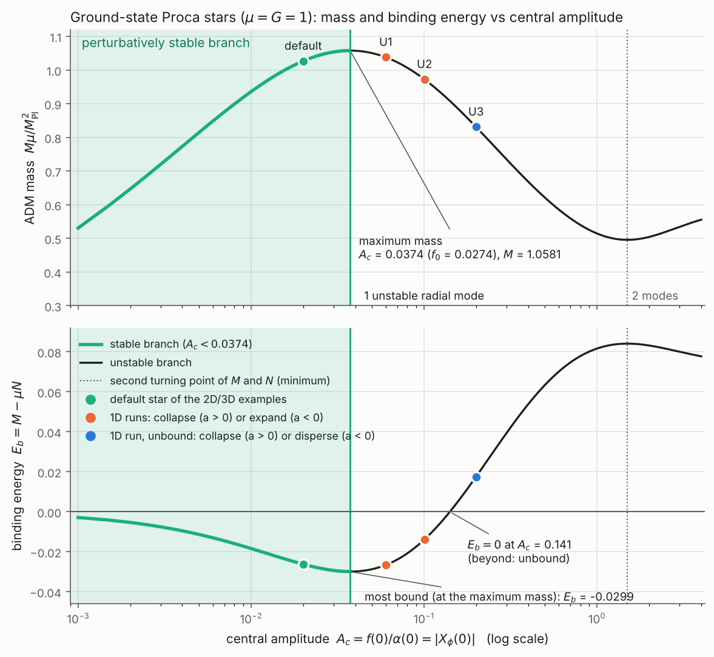

# Proca stars in axisymmetry (ProcaStar_2D)

This is the axisymmetric (modified cartoon) version of the Proca stars of Spherical_BS_Evolver (`proca-stars`
branch): a complex Proca field of mass mu coupled to CCZ4. The conventions are those of the 1D code, with signature
(-,+,+,+) and K_ij = -nabla_i n_j:

    L = -1/4 F_ab Fbar^ab - 1/2 mu^2 A_a Abar^a,     A = e^{-i omega t} (f dt + i g dr)   for the star.

ExoZvezda's `proca-stars` branch has the same stars in full 3D (SingleProcaStar, BinaryProcaStar) with the same
initial data code.

**Branch.** This branch is built on `dirac-stars`. It reuses the vacuum cartoon classes `CCZ4CartoonBase` /
`ConstraintsCartoonBase` and the `CARTOON_NO_SCALAR_FIELD` guard introduced there.

## Files

| File | Contents |
|---|---|
| `Source/Matter/ProcaFieldCartoon.hpp` | Proca variables, 3+1 right-hand side, stress tensor, number density and Gauss constraint on the cartoon plane |
| `Source/Cartoon/CCZ4CartoonProca.hpp` | CCZ4 cartoon RHS with Proca matter |
| `Source/Cartoon/ConstraintsCartoonProca.hpp` | Ham/Mom with Proca sources; also the diagnostics `N`, `mod_Xphi`, `n` and `Gauss` (see below) |
| `Source/InitialConditions/ProcaStars/ProcaStarSolution.hpp` | Port of the 1D Proca star solver: shooting, isotropic transformation, Gaussian perturbation, mini/quartic/solitonic potentials |
| `Source/InitialConditions/ProcaStars/ProcaStarBoost.hpp` | Boosted star: lab metric, lapse, shift and K_ij as for the boson stars, plus the transformation of A and F (shared with ExoZvezda) |
| `Source/InitialConditions/ProcaStars/ProcaStar.hpp` | 2D initial data: a single star at rest or boosted along the axis, or a head-on binary along the axis |
| `Source/TaggingCriteria/ProcaAndChiExtractionTaggingCriterion.hpp` | Tagging on X_phi and chi, as for the scalar field |
| `Examples/ProcaStar_2D/` | Level, parameters (`params.txt`), variables |
| `derivations/` | Python checks and reference implementations (see below) |
| `tests/` | C++ vs Python test of the RHS (`test_proca_cpp.*`, no Chombo needed) and a single-box test of the assembled code (`box_test/`) |
| `family/` | Ground-state family (`proca_family.dat`, generator `make_family.cpp`) and the mass / binding-energy vs central-amplitude plot (`plot_family.py`, `proca_family.png`) |

The scripts in `derivations/` are:

- `check_proca_cartoon.py` and `proca_cartoon_ref.py`: the cartoon reduction;
- `check_proca3d.py` and `proca3d_ref.py`: the 3D equations, as in ExoZvezda;
- `check_proca_boost.py`: the boost.

## Equations

**Variables.** Following Zilhão, Witek & Cardoso (2015), as in the 1D code: X_phi = -n^a A_a, X_i = gamma_i^a A_a,
E^i = gamma^{ij} F_{ja} n^a, and the Gauss-constraint damping variable Z, each complex.

- A twist-free axisymmetric field has no azimuthal components on the cartoon plane (X_z = E^z = 0).
- The evolved components are therefore X_x, X_y, E^x, E^y, X_phi and Z: 12 real variables `Xx_Re ... Z_Im`.
- Unlike the Dirac case, nothing has to be doubled or mirrored.

**Evolution equations** (F_ij = d_i X_j - d_j X_i):

    d_t X_i   = L_beta X_i - alpha (E_i + D_i X_phi) - X_phi D_i alpha
    d_t E^i   = L_beta E^i + alpha K E^i + D_j(alpha F^{ij}) + alpha mu^2 X^i + alpha D^i Z
    d_t X_phi = L_beta X_phi + alpha K X_phi - alpha D_i X^i - X^i D_i alpha - alpha Z
    d_t Z     = L_beta Z + alpha (D_i E^i + mu^2 X_phi - kappa Z)

The Gauss constraint is C = D_i E^i + mu^2 X_phi. Only the free field is evolved, as in the 1D code. The solver still
builds self-interacting stars for families, but the example stops if `proca_lambda != 0` or `proca_solitonic = 1`.

**Cartoon terms.** These follow from the vanishing Lie derivative along the rotation about x.

- On the plane, the only nonzero component of F_ij is F_xy: the "magnetic field" is azimuthal.
- d_z V^z = V^y / y for vectors, and d_z F^{xz} = F^{xy} / y, so with sqrt(gamma) = sqrt(det(xy block) gamma_ww):

      D_i V^i           = (1/sqrt(gamma)) d_a(sqrt(gamma) V^a) + V^y / y
      D_j(alpha F^{xj}) = (1/sqrt(gamma)) d_y(sqrt(gamma) alpha F^{xy}) + alpha F^{xy} / y
      D_j(alpha F^{yj}) = -(1/sqrt(gamma)) d_x(sqrt(gamma) alpha F^{xy})

- The Lie derivatives of the in-plane components need no cartoon terms.
- The stress tensor is the 3D one restricted to the plane, with S_ww = gamma_ww [E^2/2 - B^2/2 - mu^2 (X_k X^k -
  X_phi^2)/2] (B^2 = F_ij F^ij / 2).

**Verification.**

- `derivations/check_proca_cartoon.py` builds arbitrary twist-free axisymmetric 3D data (metric, gauge, K_ij and
  complex fields) and checks:
  - that the cartoon RHS and sources equal the full 3D ones on the plane (8e-11, set by finite differences);
  - that the azimuthal components of the 3D RHS and sources vanish there, so the reduced system is closed.
- `derivations/check_proca3d.py` checks the 3D equations against the covariant 4D field equations, stress tensor and
  Noether current, and against the 1D (Spherical_BS_Evolver) equations for spherical data.

**Parities.** For a reflective boundary on the axis, X_y and E^y are odd in y. For equatorial symmetry (a reflective
x = 0 boundary), X_x and E^x are odd in x. X_phi and Z are even.

**The star at rest:**

    X_phi = -f e^{i theta}/alpha,   X_i = i g n_i e^{i theta},   E^i = E n_i e^{i theta}/(alpha psi^4),   Z = 0

Here f, g, E = f' - omega g are the isotropic profiles, n = (x, y)/r, and theta = phase pi, so that |X_phi(0)| =
A_central.

## Boosted stars and head-on binaries

These follow the boson stars of `BosonStar.impl.hpp`.

- **Single star:** `PS_rapidity` boosts the star along the symmetry axis; rapidity > 0 moves it towards -x.
- **Binary:** `PS_binary = 1` gives a head-on binary along the axis, with `PS_separation`, `PS_rapidity2`,
  `central_amplitude_proca2`, `phase2` and `mass_ratio`. X_phi, X_i and E^i of the two stars are added.
- **Metric:** `id_choice` 0, 1 or 2 selects plain superposition, the equal-mass fix or the unequal-mass fix.
- **Field:** A_mu is a covector and F_mu nu a 2-form, so the lab components follow from the coordinate Jacobian of
  t~ = cosh(xi) t + sinh(xi) x, x~ = sinh(xi) t + cosh(xi) x. There is no local Lorentz transformation of a frame, as
  there is for the spinor. With e_i = F_{t~ i~} = -E n~_i e^{-i omega t~}:

      A_t = cosh A_t~ + sinh A_x~,   A_x = sinh A_t~ + cosh A_x~,   F_tx = e_x,   F_ty = cosh e_y,   F_xy = sinh e_y,
      X_phi = -(A_t - beta^x A_x)/lapse,   E_x = -e_x/lapse,   E_y = -(cosh - beta^x sinh) e_y/lapse.

  A boost along the axis keeps the azimuthal components zero.
- **Derivation:** checked in `derivations/check_proca_boost.py`:
  - closed forms against the generic tensor transformation;
  - lab RHS against the exact time derivative;
  - mirror symmetry of binaries.
- **Interference:** both stars occupy the same field, so where they overlap they interfere and the relative phase
  matters. The superposition violates the Gauss constraint there, as it does the Hamiltonian constraint; Z damps this.

## Tests run so far (no 2D evolutions)

- **C++ vs Python reference** at 200 random points: 3e-15.
- **Ported 1D solver vs Spherical_BS_Evolver** at A = 0.005, 0.02 and 0.05:
  - M, N, omega and r_99 are identical (12 digits);
  - the isotropic profiles, including the perturbed ones, agree to the precision of the 1D output (5e-10 for psi,
    5e-12 for f, g, E).
- **Single-box test (`tests/box_test`)**, 2D initial data plus one evaluation of the full RHS and constraints on
  [-6, 6] x [0, 6] (the axis included):

  | Star | Quantity | dx = 0.1 | dx = 0.05 |
  |---|---|---|---|
  | A = 0.02 | \|d_t Proca + i omega Proca\| / \|omega Proca\| | 2.1e-7 | 1.4e-8 |
  | A = 0.02 | metric RHS | 1.6e-8 | 1.1e-9 |
  | A = 0.02 | Ham / 16 pi rho | 8.7e-7 | 5.8e-8 |
  | A = 0.02 | Gauss / \|mu^2 X_phi\| | 2.3e-7 | 1.5e-8 |
  | A = 0.06 (unstable) | \|d_t Proca + i omega Proca\| / \|omega Proca\| | 6.8e-6 | 4.2e-7 |
  | A = 0.06, perturbed | Ham / 16 pi rho | 4.0e-6 | 2.5e-7 |
  | A = 0.06, perturbed | Gauss / \|mu^2 X_phi\| | 4.1e-6 | 2.6e-7 |

  - These converge at 4th order. For the perturbed star d_t stays at a resolution-independent 3.6e-3, as it should.
  - The diagnostic n agrees with -g E/(alpha psi^4) from the 1D profiles to 2e-15.
- **Boosted star (rapidity 0.3, `box_test` mode 1, 1D solution with 120001 points):** the RHS equals the exact time
  derivative of the moving solution, and the constraints converge:

  | Quantity | dx = 0.1 | dx = 0.05 | factor |
  |---|---|---|---|
  | d_t Proca error | 3.2e-7 | 1.9e-8 | 16.8 |
  | Ham / 16 pi rho | 8.7e-7 | 5.5e-8 | 15.9 |
  | Mom | 2.0e-9 | 1.3e-10 | 15.6 |
  | Gauss / \|mu^2 X_phi\| | 4.8e-7 | 3.0e-8 | 16.0 |

  The default 30001 points leave a floor of about 2e-10 in Mom from the interpolated psi' and alpha'.
- **Head-on binary (mode 2):** for all three `id_choice` options the data are exactly mirror-symmetric, with X_x and
  E^x odd, the metric even and the shift odd.
- **Full example, initial data only** (`max_level = 0`, `max_steps = 0`):

  | dx | L2 Ham | L2 Gauss | ParticleNumber |
  |---|---|---|---|
  | 2 | 1.2e-5 | 4.4e-6 | 1.05946 |
  | 1 | 1.1e-6 | 3.3e-7 | 1.05487 |
  | 0.5 | 7.5e-8 | 2.2e-8 | 1.05365 |

  - The particle number tends to the 1D value N = 1.05324 at 2nd order. The cell sum of 2 pi y n has an O(dx^2) error
    from the axis, where the integrand's odd extension has a nonzero slope.
- **Compilation:** ProcaStar_2D compiles against Chombo (2D, MPI, gcc).

## The family (mu = G = 1)

From `family/plot_family.py`:

- **Maximum mass and particle number:** at A_c = 0.0374 (f(0) = 0.0274), with M = 1.0581 and N = 1.0880.
  - Below this the ground state is perturbatively stable (the fundamental radial mode).
  - Beyond it one radial mode is unstable. The next turning point, a mass minimum (M = 0.496) at A_c = 1.50, changes
    the stability of one more mode.
- **Binding energy:** E_b = M - mu N is minimal (-0.0299) at the maximum mass and changes sign at A_c = 0.141.
- **1D runs** with Spherical_BS_Evolver, perturbation a = +-0.01 with width 3:
  - the unstable stars at A = 0.06 (U1), 0.10 (U2) and 0.20 (U3, unbound) form an apparent horizon for a = +0.01;
  - for a = -0.01 they leave the unstable branch, expanding (U1, U2) or dispersing (U3).
- **Default star:** the examples use A = 0.02 (M = 1.027, r_99 = 15, omega = 0.904).

## Diagnostics

All of these are plottable (`plot_vars`).

| Name | Meaning |
|---|---|
| `n` | particle number density measured by the normal observers, n = -n_a j^a = Im(E^i Xbar_i) |
| `N` | n chi^{-3/2} 2 pi y, the integrand summed into `ParticleNumber` (the 1D Noether charge) |
| `mod_Xphi` | \|X_phi\|, which equals A_central at the centre of a star at rest |
| `rho` | energy density |
| `Gauss` | \|D_i E^i + mu^2 X_phi\| (its L2 norm is the last column of `constraint_norms`) |
| `M_adm`, `P_adm` | integrands of the ADM surface integrals (from `ADMQuantities`, for interpolation onto a sphere) |

There is a single (complex) field, so n is also the density of that field.

## Running

    cd Examples/ProcaStar_2D && make all && mpirun ./Main_ProcaStar2D*.ex params.txt

**Initial-data parameters** (`central_amplitude_proca`, `proca_*`) mirror Spherical_BS_Evolver's `BSParams.par` with
`proca = 1`:

- `proca_perturb*` gives the Gaussian perturbation of f and g, with the metric and E re-solved.
- `proca_solver_radius` should be at least about 4 r_99.
- The frequency search brackets automatically.
- Beyond 0.8 `proca_solver_radius` the field is continued as exp(-sqrt(mu^2 - omega^2) r)/r. For a perturbed star this
  cuts off the small Coulomb-like tail of E, a tiny Gauss violation there.

**Outputs:**

- `ParticleNumber`;
- `mod_Xphi_max`, which equals A_central for a star at rest;
- `constraint_norms` (with `L^2_Gauss`) and `min_chi`.

**Dissipation.** The first-order Proca system needs Kreiss-Oliger dissipation, applied to all variables (`sigma =
0.3`). The 1D code needed `damping_factor` of about 1 at its origin.

**Apparent horizons.** The example compiles with or without `USE_AHFINDER` (PETSc), like the scalar-field examples.
With it, `AH_activate = 1` puts a horizon finder on the star (on each star plus their merger for a binary), e.g. to
detect the collapse of an unstable star. The initial guesses are `AH_1_initial_guess` / `AH_2_initial_guess`
(default 0.3), contracted along the axis by sqrt(1 - v^2) for boosted stars.

The grid, AMR and tagging values in `params.txt` are untested starting points.
